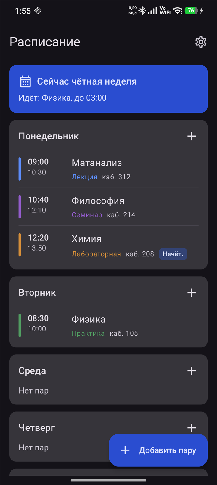
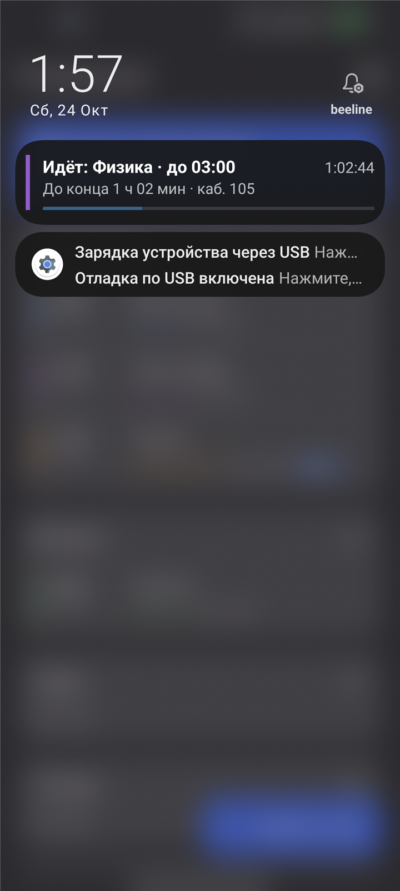

# Расписание на экране блокировки

Android-приложение, которое держит текущую (или следующую) пару в постоянном
уведомлении на экране блокировки: название, время до конца, живой обратный отсчёт,
кабинет и полоска прогресса. Расписание ручное, с чётными/нечётными неделями,
типами пар и настраиваемой сеткой звонков.

<p align="center">
  
  
</p>

## Возможности

- Ручное расписание на неделю (Пн–Вс): начало и окончание, название, кабинет.
- Чётные / нечётные недели у каждой пары и настраиваемая опорная неделя.
- Типы пар: лекция, практика, семинар, лабораторная, другое — с цветной меткой.
- Постоянное уведомление: заголовок «Идёт: … · до …», обратный отсчёт,
  полоска прогресса и цветная полоса типа пары.
- Состояния: пара идёт / до начала / на сегодня всё / сегодня пар нет / расписание пусто.
  Если сегодня пар нет — показывается ближайшая пара.
- Мастер-переключатель, отдельный переключатель показа на экране блокировки,
  плитка в быстрых настройках, кнопки «Скрыть» и «Отключить» в уведомлении.
- Сетка звонков с готовым пресетом и подстановкой времени в редактор пары.
- Резервная копия расписания в JSON (экспорт и импорт через системный выбор файла).
- Русский и английский интерфейс, светлая / тёмная / системная тема.
- Работает без интернета и без аккаунта: все данные хранятся только на устройстве.

## Установка

### Требования

- Android 8.0 (API 26) или новее.
- Разрешение на установку приложений из неизвестных источников для файлового
  менеджера или браузера, которым вы откроете APK.

### Шаги

1. Откройте [последний релиз](https://github.com/flan1e/schedule-on-the-lock-screen/releases/latest)
   и скачайте файл `schedule-<версия>.apk`.
2. Откройте скачанный файл. Если система спросит — разрешите установку из этого
   источника (Настройки → Приложения → Специальный доступ → Установка неизвестных
   приложений).
3. Запустите «Расписание» и разрешите уведомления — без них приложение не сможет
   показывать пару на экране блокировки.
4. Добавьте пары и включите показ на экране блокировки в настройках приложения.

> **Важно.** APK из релизов подписан отдельным ключом. Если у вас уже установлена
> debug-версия (например, собранная из исходников), её нужно удалить перед установкой
> релиза: Android не даст поставить приложение с другой подписью. Данные при этом
> пропадут — при необходимости сначала сделайте экспорт расписания.

### Xiaomi / Redmi / POCO (MIUI, HyperOS)

Система агрессивно экономит батарею, поэтому уведомление может исчезать. Чтобы
оно жило постоянно:

- Настройки → Приложения → Расписание → Уведомления: разрешить, включить
  «Показывать на экране блокировки», важность — не ниже «Низкая».
- Настройки → Приложения → Расписание → Батарея → «Без ограничений».
- Настройки → Приложения → Автозапуск → разрешить для «Расписания».
- Настройки → Уведомления → «Показывать содержимое на экране блокировки» (если
  включено скрытие содержимого, вместо текста будет «Содержимое скрыто»).

На других прошивках (ColorOS, One UI и т. п.) достаточно снять ограничения батареи
для приложения.

## Первый запуск

1. На экране расписания нажмите «+» и добавьте пары: день, время, название, кабинет,
   тип и чётность недели.
2. Откройте «Настройки → Расписание → Опорная неделя» и укажите дату с известной
   чётностью — от неё считается чередование недель. По умолчанию это 1 сентября
   текущего года (нечётная неделя).
3. При желании настройте «Сетку звонков»: номера пар со временем начала и окончания.
   Потом в редакторе пары время можно подставлять одним нажатием.
4. Включите «Показывать на экране блокировки». Уведомление появится сразу и будет
   обновляться само.

Резервная копия: «Настройки → Резервная копия → Экспорт». Файл JSON содержит пары,
типы и опорную неделю; импорт заменяет расписание целиком.

## Как работает уведомление

- Заголовок: «Идёт: Матанализ · до 11:10» или «Следующая: Физика · в 12:20».
- Текст: «До конца 45 мин · каб. 312», справа тикает системный хронометр.
- Полоска прогресса показывает, какая часть пары прошла.
- Слева — цветная полоса типа пары: синяя (лекция), зелёная (практика),
  фиолетовая (семинар), оранжевая (лабораторная). У типа «Другое» полосы нет.
- В развёрнутом виде добавляются интервал пары, день (если пара не сегодня)
  и следующая пара.
- Цвета текста подстраиваются под системную тему, а не под тему приложения.

Обновление состояния происходит на границе минуты; секунды в уведомлении тикает
система, поэтому отсчёт остаётся точным даже в глубоком сне.

## Приватность и разрешения

Приложение не имеет доступа в интернет: в манифесте нет `INTERNET`. Расписание,
настройки и резервные копии не покидают устройство, если вы сами не поделитесь файлом.

Используются только разрешения, необходимые для уведомления:

```xml
POST_NOTIFICATIONS
FOREGROUND_SERVICE
FOREGROUND_SERVICE_SPECIAL_USE
RECEIVE_BOOT_COMPLETED
```

Нет точных будильников, доступа к календарю, контактам и хранилищу (файлы для
экспорта/импорта выбираются через системный диалог SAF).

## Сборка из исходников

Требования: JDK 17, Android SDK с `platforms;android-36` и `build-tools;36.0.0`.
Gradle идёт через wrapper.

```bash
# путь к SDK: переменная ANDROID_HOME или local.properties
echo "sdk.dir=C:\\path\\to\\Android\\Sdk" > local.properties

./gradlew assembleDebug        # debug APK
./gradlew testDebugUnitTest    # unit-тесты
./gradlew installDebug         # установка на подключённое устройство
```

Debug APK: `app/build/outputs/apk/debug/app-debug.apk`.

Для подписанного release создайте `keystore.properties` по образцу
`keystore.properties.example` (файл и папка `keystore/` в `.gitignore`) и выполните:

```bash
./gradlew assembleRelease
```

Без `keystore.properties` release собирается, но остаётся неподписанным.

Проект использует version catalog (`gradle/libs.versions.toml`):
AGP 8.13.2, Gradle 8.14.6, Kotlin 2.3.21, Compose BOM 2026.06.01,
Room 2.8.5, DataStore 1.2.1. `compileSdk`/`targetSdk` — 36, `minSdk` — 26.

Lifecycle 2.9.4 и Navigation 2.9.8 зафиксированы осознанно: более новые версии
(2.11 / 2.10) уже требуют AGP 9.1 и `compileSdk 37`, а AGP 8.13.2 официально
поддерживает максимум API 36.

## Архитектура

MVVM + Coroutines/Flow + Repository, один модуль `app`, без Hilt:
граф зависимостей собран вручную в `di/AppContainer`.

```
com.flan1e.schedule
├── domain
│   ├── model        Lesson, WeekParity, LessonOccurrence, ScheduleState, AppSettings
│   └── logic        WeekParityCalculator, ScheduleResolver, CountdownCalculator
├── data
│   ├── local        Room: LessonEntity, LessonDao, AppDatabase
│   ├── backup       BackupCodec (JSON без внешних зависимостей)
│   └── repository   ScheduleRepository, SettingsRepository (DataStore)
├── notification     foreground-служба, notifier, ресиверы, QS-тайл, контроллер службы
├── ui               Compose: расписание, редактор пары, настройки, тема
├── util             форматирование времени/длительности, цвета типов, локаль
└── di               AppContainer
```

- **Домен** не зависит от Android: чистые функции с явной передачей `LocalDateTime`,
  поэтому логика полностью покрывается JVM-тестами.
- **UI** получает состояние из `StateFlow`; экран настроек общается с ViewModel
  через `SettingsEvent` и не знает о репозиториях.
- **Служба** подписана на Flow расписания и настроек: любое изменение сразу
  отражается в уведомлении.

### Хранение

- Room: таблица `lessons` (`day_of_week`, `start_minute`, `end_minute`, `title`, `room`,
  `parity`, `kind`). Время хранится минутами от полуночи, даты нет: расписание
  повторяется каждую неделю. Схема v2: тип пары добавлен миграцией 1→2
  (`ALTER TABLE lessons ADD COLUMN kind TEXT NOT NULL DEFAULT 'OTHER'`).
- DataStore Preferences: мастер-переключатель, экран блокировки, состав уведомления,
  тема, язык, опорная дата и её чётность, сетка звонков (строкой `510-600,610-700`).

## Логика выбора пары

`ScheduleResolver.resolve(now, lessons, anchorDate, anchorIsOdd)`:

1. Строит вхождения пар на 21 день вперёд (и на вчера назад — чтобы поймать пару,
   перешедшую через полночь).
2. Для каждой даты вычисляет чётность недели:
   `parity = anchorIsOdd XOR (floorMod(недель между понедельниками, 2) == 1)`.
   Неделя начинается с понедельника.
3. Ищет идущую пару (`start <= now < end`); при пересечении выбирает начавшуюся позже.
4. Иначе — ближайшую будущую пару. Если она сегодня — `Upcoming`, если сегодня пары
   были, но закончились — `TodayFinished`, если сегодня пар нет — `TodayEmpty`.
   В обоих последних случаях передаётся ближайшая пара в следующие дни.
5. Пары через полночь поддерживаются: окончание переносится на следующий день,
   чётность определяется по дню начала.

Обратный отсчёт округляется вниз до минут для текста; секунды показывает
системный chronometer, поэтому значения совпадают.

### Опорная неделя и ручное переопределение

Пользователь задаёт дату и чётность опорной недели. Переопределение текущей недели
не хранится отдельным флагом: приложение сдвигает опорную дату на неделю, поэтому
дальнейший расчёт остаётся автоматическим и консистентным. Кнопка «Сбросить
к 1 сентября» возвращает опорную неделю к умолчанию.

## Типы пар

- `LessonKind`: `LECTURE`, `PRACTICE`, `SEMINAR`, `LAB`, `OTHER` (по умолчанию).
  На выбор текущей/следующей пары тип не влияет — это только визуальная метка.
- В редакторе пары — ряд чипов с цветной точкой: «Лекция», «Практика», «Семинар»,
  «Лабораторная», «Другое».
- В списке расписания слева от времени — цветная полоса, а в строке с кабинетом —
  подпись типа тем же цветом. Цвета фиксированные (`util/LessonKindColors`),
  чтобы совпадать в списке и в уведомлении: синий `#4C8DFF`, зелёный `#2E9E5B`,
  фиолетовый `#9B59D0`, оранжевый `#E08A1E`; у «Другого» — серая полоса.
- В уведомлении тип показывается только цветной полосой слева; у «Другого»
  полоса скрыта. Подпись в уведомление не добавляется, чтобы не менять его формат.

## Сетка звонков и резервная копия

- Сетка звонков — это пресет времени пар (номер = позиция в списке). Хранится в
  DataStore, правится в «Настройки → Расписание → Сетка звонков», есть кнопка
  «Стандартная сетка». В редакторе пары появляются чипы «1 · 08:30–10:00»:
  нажатие подставляет начало и окончание, ручной ввод времени остаётся.
- Экспорт/импорт — JSON через системный SAF (`CreateDocument`/`OpenDocument`),
  без разрешений на хранилище и без интернета. Формат:
  `{"format":"schedule-backup","version":1,"anchorDate":"2026-09-01","anchorIsOdd":true,"lessons":[...]}`.
  В файл попадают и пары, и опорная неделя — без неё нельзя восстановить
  чётность. Тип пары (`kind`) пишется в файл; в старых файлах его нет, такие
  пары получают «Другое». Импорт заменяет расписание целиком после подтверждения;
  пары пишутся одной транзакцией Room.
- Кодек (`data/backup/BackupCodec.kt`) — чистый Kotlin со своим минимальным
  JSON-парсером: без `org.json` и `kotlinx.serialization`, поэтому покрыт
  обычными unit-тестами.

## Уведомление и фон

- `ScheduleForegroundService` с типом `specialUse`: `dataSync` на Android 15+
  ограничен 6 часами в сутки, а здесь нужен постоянный режим.
- Канал `IMPORTANCE_LOW`, без звука и вибрации, `lockscreenVisibility = PUBLIC`.
- Уведомление: `setOngoing(true)`, `setOnlyAlertOnce(true)`,
  `setVisibility(PUBLIC)`, `setCategory(STATUS)`.
- Раскладка уведомления — собственный `RemoteViews`
  (`res/layout/notification_content.xml`), а не системный шаблон: на Android 16
  при `setProgress` системный шаблон отводит тексту узкую колонку справа от
  заголовка и прячет chronometer. Свой layout сохраняет и то, и другое.
  Цветная полоса типа пары — тоже часть этого layout.
- Обратный отсчёт — `Chronometer` в этом layout: секунды тикает система,
  приложению не нужно просыпаться каждую секунду. Текстовая строка
  «До конца 45 мин» пересчитывается на границе минуты.
- В свёрнутом виде: заголовок «Идёт: Матанализ · до 11:10» (или «Следующая: Физика»),
  текст «До конца 45 мин · каб. 312», хронометр `44:31` справа и полоска прогресса
  пары. В развёрнутом виде добавляются интервал пары, день (для не сегодняшних пар)
  и следующая пара.
- Цвета текста в layout зависят от системной темы, а не от темы приложения
  (`NotificationPalette`); при смене темы служба перерисовывает уведомление
  сразу через `onConfigurationChanged`.
- Служба останавливается, когда выключен мастер-переключатель или показ на lock screen:
  нет смысла держать foreground-службу, если показывать нечего.
- Запуск: при старте приложения (из `MainActivity.onStart`, то есть на переднем плане),
  после `BOOT_COMPLETED`, `MY_PACKAGE_REPLACED`, `TIME_SET`, `TIMEZONE_CHANGED`,
  из QS-тайла и по действиям в уведомлении.
- Изменение настроек сразу применяется: `SettingsViewModel` после записи
  синхронизирует службу.
- Разрешение `POST_NOTIFICATIONS` (Android 13+) запрашивается один раз при первом
  запуске; если отклонено, на экране расписания висит баннер с кнопкой.

## Тесты

```bash
./gradlew testDebugUnitTest
```

Покрыто:

- `WeekParityCalculatorTest` — чётность относительно опорной даты, прошлые недели,
  граница года, опорная дата в середине недели, чётная опорная неделя.
- `ScheduleResolverTest` — идущая пара, границы начала/конца, перерыв, после последней
  пары, пустой день, чётные/нечётные недели, пара через полночь, граница Вс→Пн,
  пересечения, следующая пара, пустое расписание.
- `CountdownCalculatorTest` — округление остатка до минут.
- `BellScheduleTest` — стандартная сетка, кодирование/декодирование, битые записи,
  номера пар, пара через полночь.
- `BackupCodecTest` — round-trip экспорта/импорта, экранирование, пустое расписание,
  битый JSON, неверный день/время, неизвестная чётность.

Всего 44 теста, все проходят на JVM без Android-эмулятора.

## Известные ограничения

- **Экран блокировки.** Официального API для виджетов на lock screen в «чистом»
  Android нет, поэтому используется уведомление с `visibility = public`.
  Итоговый вид зависит от производителя и системных настроек: если на устройстве
  включено «Скрывать содержимое уведомлений», текст будет скрыт, несмотря на `public`.
- **Android 13+** требует разрешение на уведомления; без него foreground-служба
  работает, но пользователь не видит уведомление.
- **Android 14+** разрешает смахивать `ongoing`-уведомления. Приложение не борется
  с системой: при смахивании служба останавливается, показ на lock screen выключается.
  Включить снова можно переключателем в приложении или плиткой в быстрых настройках.
- **Агрессивная экономия батареи** (MIUI/HyperOS, ColorOS, Samsung и др.) может
  убивать foreground-службу. На таких устройствах нужно разрешить автозапуск
  и снять ограничения батареи вручную.
- **Точность обновления.** Смена состояния происходит на границе минуты; при глубоком
  сне тик может прийти с задержкой, но chronometer всё равно показывает корректное время.
- **Нет синхронизации** с календарём/вузовским API и нет виджета на домашнем экране.
- Пары через полночь поддерживаются, но в интерфейсе помечаются как `+1`; чётность
  считается по дню начала.
- Названия пар и кабинеты — пользовательские данные, они не переводятся.

## Лицензия

[MIT](LICENSE). Можно использовать, изменять и распространять с сохранением
уведомления об авторстве. Приложение предоставляется «как есть», без гарантий.
